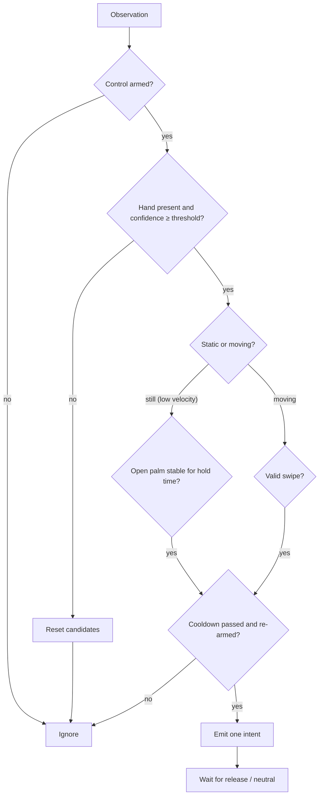

# ADR-003: Distinguishing intentional gestures from accidental movement

Status: Accepted (thresholds are tuning starting points)

## Context

A gesture recognized in one frame is an observation, not a command. Accidental commands are the top product risk. The chosen gesture pair also interferes with itself: a swipe is usually performed with an open palm, and every swipe has a return stroke in the opposite direction.

## Decision

The `GestureStateMachine` emits at most one intent per deliberate gesture, using:

| Rule                           | Initial value                                                                                                                                                                                                                                                                                                                                                                     |
| ------------------------------ | --------------------------------------------------------------------------------------------------------------------------------------------------------------------------------------------------------------------------------------------------------------------------------------------------------------------------------------------------------------------------------- |
| Explicit arming                | Start Control; camera-on and commands-enabled are separate states                                                                                                                                                                                                                                                                                                                 |
| Static pose confidence         | **Revised after Week 1 recordings:** start at ≥ 0.50 (the classifier's own floor) and rely on stability + stillness. Deliberate palm holds scored a median of 0.53–0.61 and almost never reached 0.80, while brief accidental palms during normal activity did. Confidence alone does not separate intent. Evaluate a landmark-based open-palm check (finger extension) in Week 3 |
| Palm hold time                 | 800 ms, user-adjustable 500–1500 ms                                                                                                                                                                                                                                                                                                                                               |
| **Stillness for static pose**  | Palm-center velocity below a threshold for the whole hold; any swipe-like motion resets the hold timer                                                                                                                                                                                                                                                                            |
| Swipe                          | Horizontal wrist/palm displacement ≥ 25 % of frame width within ≤ 500 ms, dominant horizontal direction (abs(dx) ≥ 2 × abs(dy))                                                                                                                                                                                                                                                   |
| **Return-stroke suppression**  | After a swipe, ignore opposite-direction motion for 700 ms. **Week 1 data:** return strokes are as fast as swipes (≥ 25 % of frame in < 500 ms) and start 0.6–1.2 s after the swipe begins, so 700 ms from swipe end is borderline. Consider 1,000 ms, or require the hand to come to rest before the next swipe                                                                  |
| Global cooldown                | 1,000 ms between emitted intents                                                                                                                                                                                                                                                                                                                                                  |
| Re-arm                         | Same gesture fires again only after release. **Week 1 data:** users often keep the hand in view between holds, so release cannot depend on the hand disappearing. Detect lowering or relaxing (fingertips dropping), a pose change, or loss of tracking                                                                                                                           |
| **Wind-up suppression**        | **Added after Week 1 data:** people often move the hand quickly the opposite way just before a swipe. A swipe must start from a brief pause, or opposite-direction candidates are held for a short window and discarded if a larger swipe follows                                                                                                                                 |
| **Direction semantics**        | Left/right defined from the user's perspective; mirroring of the preview handled in one place (`swipe-detector.ts`)                                                                                                                                                                                                                                                               |
| Tracking loss / low confidence | Reset candidates; never a command                                                                                                                                                                                                                                                                                                                                                 |
| Multiple hands                 | Use only the highest-confidence hand; show a hint                                                                                                                                                                                                                                                                                                                                 |

Safe failure: recognizer crash, host disconnect, Stop pressed, or target-tab change → dispatch disabled before any cleanup.

## Consequences

- The state machine is pure TypeScript with injected time, fully unit-testable.
- Thresholds are validated with recorded landmark sessions replayed in tests (see `testing/test-plan.md`); changes must be justified by replay results.
- Accessibility: hold time and swipe distance are adjustable; no gesture assumes a fully extended palm or fast motion is achievable by everyone. Manual controls always remain available.
