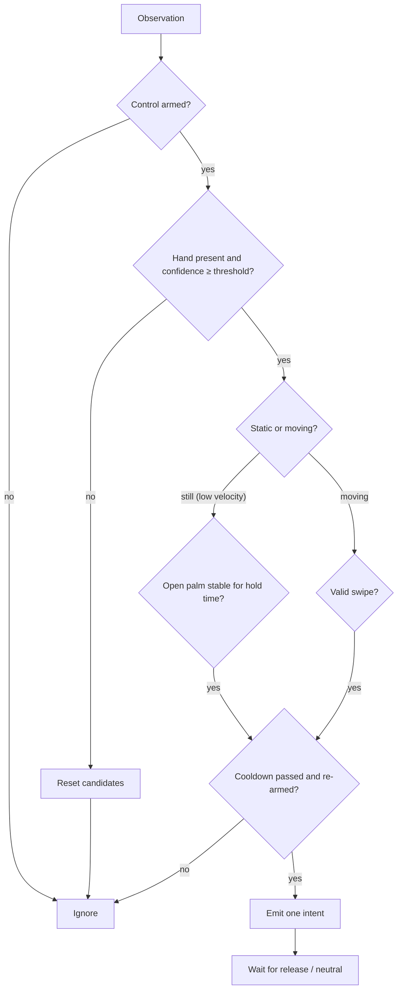

# ADR-003: Distinguishing intentional gestures from accidental movement

Status: Accepted. Thresholds fitted to Week 1 recordings (Week 3); retune only with replay evidence

## Context

A gesture recognized in one frame is an observation, not a command. Accidental commands are the top product risk. The chosen gesture pair also interferes with itself: a swipe is usually performed with an open palm, and every swipe has a return stroke in the opposite direction.

## Decision

The gesture engine emits at most one intent per deliberate gesture, using:

Implemented in `src/interaction/gesture-engine.ts` (Week 3). Values were fitted to the Week 1 recordings and are enforced by `tests/unit/replay.test.ts`.

| Rule                      | Value                                                                                                                                              | Why (from the recordings)                                                                                   |
| ------------------------- | -------------------------------------------------------------------------------------------------------------------------------------------------- | ----------------------------------------------------------------------------------------------------------- |
| Explicit arming           | Start Control; camera-on and commands-enabled are separate states                                                                                  |                                                                                                             |
| Palm score floor          | ≥ 0.50                                                                                                                                             | Deliberate holds scored 0.53–0.61; brief accidental palms reached 0.80, so stillness decides, not the score |
| Palm hold                 | Palm stays within 0.07 of an anchor point (scaled up for bigger, closer hands) and within 15 % hand-size change for **700 ms**                     | Users push the palm toward the camera and hold briefly; a stricter radius missed most holds                 |
| Re-arm after a hold       | Hand moves ≥ 0.06 (or changes size ≥ 15 %), or the palm is gone > 250 ms                                                                           | The hand often stays in view between holds                                                                  |
| Edge margin               | Holds only count with the palm center ≥ 0.1 inside the frame                                                                                       | A hand resting at the frame edge after a swipe looked like a hold                                           |
| Swipe                     | One continuous horizontal motion (≥ 0.4 frame widths/s) covering ≥ 25 % of the frame, horizontal ≥ 1.5 × vertical, peak ≥ 0.8/s, ≥ 3 frames, ≤ 1 s | Real swipes took 0.4–1.1 s; the earlier 500 ms limit missed them                                            |
| Return-stroke suppression | Ignore the opposite direction for **1.5 s after the swipe motion ends**                                                                            | Return strokes are sometimes faster than the swipe, so speed cannot tell them apart                         |
| Tracking jumps            | A step > 0.35 or a gap > 200 ms breaks any motion or hold                                                                                          | Hand switches and re-detections produced one-frame "swipes"                                                 |
| Wind-up                   | No separate rule needed                                                                                                                            | The apparent wind-ups were tracking jumps, handled above                                                    |
| Global cooldown           | 1,000 ms between intents                                                                                                                           |                                                                                                             |
| Direction                 | Raw image x grows toward the user's left; mapped in one place                                                                                      | The frame is not mirrored                                                                                   |
| Fist                      | Never a command; a fist frame never extends a swipe                                                                                                | Natural fists appeared during normal activity                                                               |
| Tracking loss             | Resets candidates; never a command                                                                                                                 |                                                                                                             |
| Multiple hands            | Use the highest-scoring hand; show a hint                                                                                                          |                                                                                                             |

Replay results (Week 3): zero intents in every normal-activity segment; 8 of ~10 palm holds; 9 of ~10 left swipes; all tracked right swipes (7 of 6–8 in the dedicated file); no wrong-direction swipes. In the combined recording most right swipes were not tracked (hand low, partly out of frame), which the hand guide now warns about.

Safe failure: recognizer crash, host disconnect, Stop pressed, or target-tab change → dispatch disabled before any cleanup.

## Consequences

- The engine is pure TypeScript that takes time from observation timestamps, so recordings replay exactly.
- Thresholds are validated with recorded landmark sessions replayed in tests (see `testing/test-plan.md`); changes must be justified by replay results.
- Accessibility: hold time and swipe distance are adjustable; no gesture assumes a fully extended palm or fast motion is achievable by everyone. Manual controls always remain available.
