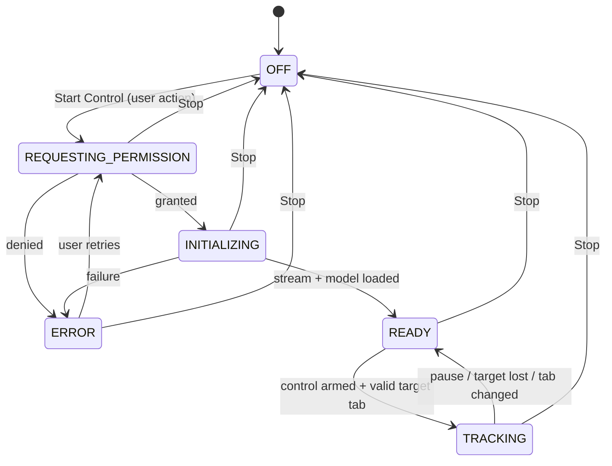

# Execution Contexts and Lifecycle

## The constraint that drives this design

The user watches YouTube in the foreground while the camera is running. **Whatever context owns the camera must keep running inference while it is not the focused tab.**

- A regular extension tab (e.g. `control.html` opened in a tab) becomes a _hidden_ document when the user switches to YouTube. Chrome pauses `requestAnimationFrame` and throttles timers in hidden documents, so recognition would stall exactly when it is needed. **This option is rejected.**
- The popup closes when it loses focus. **Rejected.**
- The service worker has no DOM, no `getUserMedia`, and is terminated when idle. **Rejected for camera work.**

Candidates evaluated in the Week 1 spike (ADR-001):

| Candidate                                        | Visible while YouTube is focused | Camera permission prompt                                                                                                                                    | Lifecycle risk                                                                  |
| ------------------------------------------------ | -------------------------------- | ----------------------------------------------------------------------------------------------------------------------------------------------------------- | ------------------------------------------------------------------------------- |
| **A. Side Panel**                                | Yes, beside the tab              | **Confirmed (Week 1):** the prompt does not display from a side panel; fallback is to grant once from an extension tab (permission is per extension origin) | Closing the panel ends the camera — acceptable and arguably desirable           |
| **B. Offscreen document** (`reason: USER_MEDIA`) | Not a visible surface            | Cannot prompt; permission must already be granted from a visible extension page                                                                             | Invisible camera use — requires an always-visible indicator (action badge + UI) |
| C. Separate popup window                         | Yes, unless occluded/minimized   | Works                                                                                                                                                       | **[To verify]** occlusion may throttle; fragile UX                              |

Default preference: **A (Side Panel)**, because the camera owner is visible and closing it naturally stops the camera. B is the fallback if A fails the spike.

Independently of the host, the frame loop must not depend on `requestAnimationFrame`. Preferred: `MediaStreamTrackProcessor` feeding a dedicated worker, or `HTMLVideoElement.requestVideoFrameCallback` — **[To verify]** which keeps running at the target rate in the chosen host.

## Contexts and ownership

| Context                               | Owns                                                            | Lifetime                                                 |
| ------------------------------------- | --------------------------------------------------------------- | -------------------------------------------------------- |
| Camera host (Side Panel or offscreen) | `MediaStream`, frame loop, MediaPipe, state machine, dispatcher | From Start Control until Stop / close / crash            |
| Recognition worker (optional)         | MediaPipe inference                                             | Child of camera host                                     |
| Service worker                        | Routing, tab events, session validation                         | Event-driven; may be terminated after ~30 s idle         |
| YouTube content script                | `YouTubeAdapter`                                                | Per YouTube page; survives SPA navigation                |
| Control UI                            | Rendering state, user input                                     | May be the same document as the camera host (Side Panel) |

## Camera lifecycle state machine

| State                   | Camera   | Commands permitted | UI shows                                          |
| ----------------------- | -------- | ------------------ | ------------------------------------------------- |
| `OFF`                   | Off      | No                 | "Control is off", Start Control                   |
| `REQUESTING_PERMISSION` | Off      | No                 | Why the camera is needed                          |
| `INITIALIZING`          | Starting | No                 | Loading indicator, Stop                           |
| `READY`                 | On       | No                 | Camera on, "Not controlling" + reason, Stop       |
| `TRACKING`              | On       | **Yes**            | Control Active, controlled tab, hand status, Stop |
| `ERROR`                 | Released | No                 | What failed, Retry, Stop                          |

Hand presence ("no hand detected") is a sub-status of `TRACKING`, not a separate lifecycle state. It never produces a command.

## Lifecycle rules

1. Camera starts only after an explicit user action. Nothing — extension update, browser restart, service-worker restart — reactivates it automatically.
2. **Stop order:** disable dispatch first (synchronously), then stop all `MediaStreamTrack`s, cancel the frame loop, close the recognizer. Tracks stopped within 1 s.
3. Camera host closed or crashed → service worker invalidates the session; any in-flight command from that session is rejected.
4. Controlled tab closes, navigates off a supported page, or the user selects another tab → `TRACKING → READY` until the target is revalidated.
5. Recognizer or stream failure → `ERROR`, dispatch disabled until the user explicitly retries.
6. Session state the service worker needs (`sessionId`, `targetTabId`, `controlEnabled`) lives in `chrome.storage.session`, never only in module variables.
7. Verify on the target Chrome version that closing the host releases the camera (the camera indicator turns off); do not assume.

## Target tab selection

- MVP rule: the controlled tab is the YouTube watch tab that was active when control was armed, or the one the user picks in the UI.
- The UI always displays which tab is controlled.
- If the controlled tab is not `youtube.com/watch*`, commands are rejected with `UNSUPPORTED_PAGE`.
