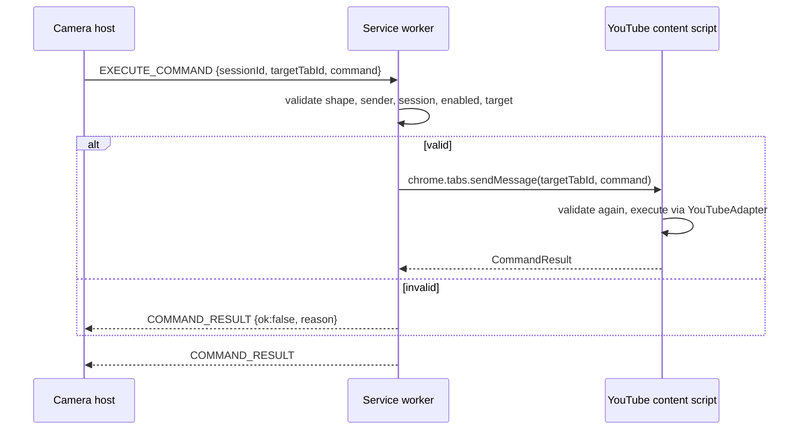

# Message Contracts

All cross-context messages are untrusted input. TypeScript types describe them; hand-written runtime guards in `src/messaging/validate.ts` enforce them.

## Envelopes

```ts
type ExtensionMessage =
  | { type: 'SESSION_START'; sessionId: string } // camera host → SW
  | { type: 'SESSION_END'; sessionId: string } // camera host → SW
  | {
      type: 'CONTROL_STATE_CHANGED';
      sessionId: string;
      enabled: boolean;
      targetTabId: number | null;
    }
  | {
      type: 'EXECUTE_COMMAND';
      sessionId: string;
      commandId: string;
      targetTabId: number;
      command: BrowserCommand;
      issuedAt: number;
    }
  | { type: 'COMMAND_RESULT'; sessionId: string; commandId: string; result: CommandResult }
  | {
      type: 'TARGET_CHANGED';
      targetTabId: number | null;
      reason: 'closed' | 'navigated' | 'unsupported' | 'user';
    };
```

`sessionId` is a random UUID (`crypto.randomUUID()`) created by the camera host on each Start Control. `commandId` correlates results and latency measurements.

## Flow



**Decision (Week 4): the camera host sends commands directly to the tab** with `chrome.tabs.sendMessage`, and no service-worker relay is used. The Side Panel is the only sender, it owns the session and the arming state (`TRACKING` only while a YouTube watch tab is the active tab in its window), and the content script validates every message independently. A relay would add a hop and session state that must survive service-worker restarts, without adding a check the two ends don't already make. Revisit this if a second sender appears (for example, an offscreen host or keyboard commands from the service worker).

The diagram above shows the original relay design and is kept for reference.

## Validation rules

Service worker, before forwarding:

1. Message matches a known `type` and exact shape; unknown fields rejected.
2. `sender.id === chrome.runtime.id` and sender URL is the camera host page.
3. `sessionId` equals the active session in `chrome.storage.session`; control is enabled.
4. `targetTabId` equals the stored target tab; tab still exists and its URL matches `https://www.youtube.com/watch*`.
5. `command.type` is allowlisted; `deltaSeconds ∈ {-10, 10}`.

Content script, before executing:

1. Message came from the extension (`sender.id === chrome.runtime.id`, no `sender.tab`).
2. Same shape and allowlist checks.
3. Never reads instructions from the page DOM, `window.postMessage`, or page scripts.

## Prohibited

- Messages carrying JavaScript, CSS selectors, URLs to fetch, or free-form instructions.
- `externally_connectable` or any listener for web-page-originated messages.
- Sending camera frames or landmarks outside the camera host (landmarks may go to a worker in the same context).
- Silent failure: every `EXECUTE_COMMAND` receives exactly one `COMMAND_RESULT`.
