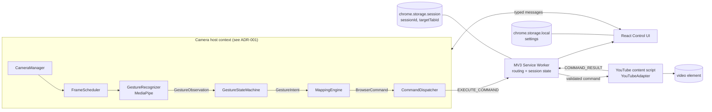

# Software Architecture

Owner: Tech Lead / Architect

## Principles

1. **Recognition observes; it never acts.** MediaPipe reports what it sees. Only the interaction engine decides whether an observation is a deliberate command.
2. **Three independent layers.** Recognition knows nothing about commands; the interaction engine knows nothing about websites; adapters know nothing about cameras.
3. **Fail closed.** Any uncertainty — low confidence, lost tracking, stale session, changed tab, crashed recognizer — results in _no command_.
4. **Local only.** No backend, no network traffic carrying camera data.
5. **Small footprint.** No Redux, plugin framework, database, or runtime schema library unless a concrete requirement appears.

## Component view



Google Slides is a future second adapter behind the same `SiteAdapter` interface; it requires no change to recognition or interaction code.

## Responsibilities

| Component                         | Responsibility                                                                                  | Must not                                             |
| --------------------------------- | ----------------------------------------------------------------------------------------------- | ---------------------------------------------------- |
| React Control UI                  | Start/Stop, status, feedback, settings, controlled-tab display                                  | Own camera permissions directly in visual components |
| `CameraManager`                   | Request, start, stop, release `MediaStream`                                                     | Interpret gestures                                   |
| `FrameScheduler`                  | Pace inference (target rate configurable); must not depend on `requestAnimationFrame` (ADR-001) | Run inference on every frame by default              |
| `GestureRecognizer`               | Wrap MediaPipe; emit normalized `GestureObservation`                                            | Emit commands                                        |
| `GestureStateMachine`             | Arming, stabilization, cooldown, re-arm (held poses only, ADR-006)n                             | Know about YouTube                                   |
| `MappingEngine`                   | Map intents to `BrowserCommand`, honoring per-gesture enable flags                              | Execute anything                                     |
| `CommandDispatcher`               | Attach session/target metadata; send; surface results                                           | Bypass validation                                    |
| Service worker                    | Browser events, routing, session validation, tab tracking                                       | Run camera or inference; keep state only in memory   |
| `YouTubeAdapter` (content script) | Execute allowlisted commands on the active video; return results                                | Accept arbitrary selectors or script from messages   |

## Core types

```ts
// recognition layer output — an observation, not a command
type GestureObservation = {
  timestamp: number; // performance.now()-based, monotonic
  handPresent: boolean;
  category: 'Open_Palm' | 'Closed_Fist' | 'None' | string;
  confidence: number; // 0..1
  landmarks?: ReadonlyArray<{ x: number; y: number; z: number }>; // 21 points
  handedness?: 'Left' | 'Right';
};

type GestureIntent = { kind: 'POSE_HOLD'; pose: 'OPEN_PALM' | 'THUMB_UP' | 'THUMB_DOWN' }; // ADR-006

type BrowserCommand = { type: 'MEDIA_TOGGLE' } | { type: 'MEDIA_SEEK'; deltaSeconds: -10 | 10 };

type CommandResult =
  | { ok: true; state?: 'playing' | 'paused'; currentTime?: number }
  | { ok: false; reason: CommandFailure };

type CommandFailure =
  | 'NO_VIDEO'
  | 'UNSUPPORTED_PAGE'
  | 'AD_PLAYING'
  | 'PLAY_REJECTED'
  | 'STALE_SESSION'
  | 'TARGET_MISMATCH'
  | 'CONTROL_DISABLED'
  | 'INVALID_MESSAGE';

interface SiteAdapter {
  canHandle(url: URL): boolean;
  execute(command: BrowserCommand): Promise<CommandResult>;
}
```

Message envelopes are specified in [message-contracts.md](message-contracts.md).

## Source layout

```
src/
├── background/service-worker.ts
├── camera-host/                 # entry for Side Panel or offscreen doc (ADR-001)
│   ├── camera-manager.ts
│   ├── frame-scheduler.ts
│   └── recognition.worker.ts    # classic worker; MediaPipe off the main thread
├── recognition/
│   ├── gesture-recognizer.ts
│   └── types.ts
├── interaction/
│   ├── gesture-engine.ts
│   ├── mapping-engine.ts
│   └── command-dispatcher.ts
├── adapters/
│   ├── site-adapter.ts
│   └── youtube/
│       ├── content-script.ts
│       └── youtube-adapter.ts
├── messaging/
│   ├── contracts.ts
│   └── validate.ts              # hand-written runtime guards
├── storage/settings-store.ts
├── design-system/               # see ux/design-system.md
├── pages/
│   ├── control-panel/           # Side Panel = camera host (ADR-001)
│   └── permission/              # one-time camera grant page
└── shared/
public/
├── manifest.json
└── mediapipe/                   # bundled wasm + .task model (ADR-002)
tests/
├── unit/
├── replay/                      # recorded landmark sessions (test-plan.md)
└── integration/
```

The build must produce separate, explicitly configured entry points for the camera host page, service worker, and content script. This is verified in the Week 1 spike, not assumed.

## Implementation order (enforced in code review)

1. Contracts and types.
2. Camera + recognition, independent of browser actions.
3. Gesture state machine, proven with replayed recordings.
4. One command end-to-end to YouTube with feedback.
5. Only then: settings, second command, polish.
