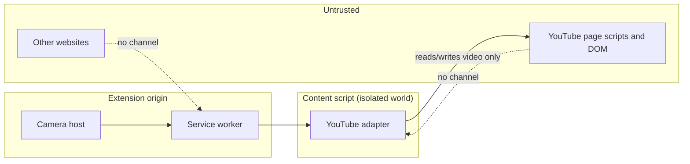

# Privacy and Threat Model

Owner: Tech Lead / Security Reviewer

## Data inventory

| Data                                       | Where it exists                         | Leaves device?      | Retention                                               |
| ------------------------------------------ | --------------------------------------- | ------------------- | ------------------------------------------------------- |
| Camera frames                              | Camera host memory only                 | **Never**           | Discarded per frame                                     |
| Hand landmarks / gesture observations      | Camera host (and its worker)            | Never               | In memory; ring buffer for the state machine            |
| Recorded landmark sessions (dev/test only) | Developer machine, explicit opt-in tool | Never automatically | Deleted after test analysis; never in production builds |
| Settings (enabled gestures, hold time)     | `chrome.storage.local`                  | No (no sync in MVP) | Until uninstall                                         |
| Session state (`sessionId`, `targetTabId`) | `chrome.storage.session`                | No                  | Cleared on browser restart                              |

No analytics, telemetry, crash reporting, or remote model download.

## Trust boundaries

## Threats and mitigations

| Threat                                                                                | Mitigation                                                                                                                         |
| ------------------------------------------------------------------------------------- | ---------------------------------------------------------------------------------------------------------------------------------- |
| Page script forges a command                                                          | No `window.postMessage` or DOM-based instruction channel; content script accepts only `chrome.runtime` messages from the extension |
| Other site messages the extension                                                     | No `externally_connectable`; no `onMessageExternal` listener                                                                       |
| Stale session issues commands after Stop or crash                                     | `sessionId` checked against `chrome.storage.session`; Stop disables dispatch before cleanup                                        |
| Command reaches the wrong tab                                                         | Target tab stored at arm time, revalidated per command (URL + existence)                                                           |
| Camera stays on unknowingly                                                           | Visible camera status in UI and action badge; Stop always reachable (button, shortcut, closing host); no auto-start                |
| Remote code injection via model/WASM                                                  | All assets bundled; CSP `script-src 'self' 'wasm-unsafe-eval'; connect-src 'self'`                                                 |
| Over-broad permissions                                                                | See ADR-005; no `<all_urls>`, `tabs`, `webRequest`, `history`, `cookies`                                                           |
| Third-party library phones home (MediaPipe usage logging to `odml.pa.googleapis.com`) | CSP `connect-src 'self'` blocks all non-extension connections; bundle URLs re-audited on every MediaPipe upgrade (ADR-002)         |
| Supply chain                                                                          | Pin dependency versions; lockfile committed; review MediaPipe updates                                                              |

## Privacy notice (draft text, must match actual behavior)

> Lophorina uses your camera only after you press Start Control. Video is processed on your device to recognize hand gestures and is never recorded, stored, or sent anywhere. The extension can only interact with YouTube pages. Press Stop Control, close the panel, or use Alt+Shift+G to turn the camera off at any time.

## Review checklist (Week 5)

- [x] No external requests from extension contexts (automated smoke test; MediaPipe logging blocked by CSP). A manual 10-minute DevTools check is still listed in the Week 5 runbook.
- [x] Final manifest permissions match ADR-005 and the code (Week 5 audit).
- [ ] Privacy notice matches observed behavior.
- [x] Dev-only recording tool is excluded from the production build.
